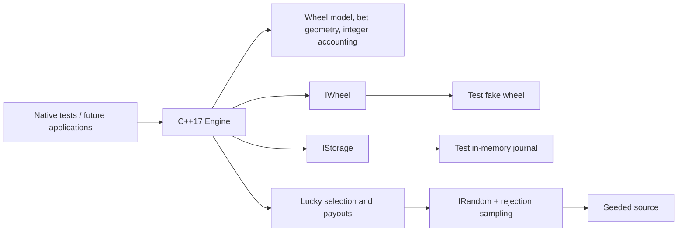

# mini-etg-roulette

**Live demo:** not deployed yet. The verified GitHub Pages link will go here after
the Phase 3B deployment succeeds.

A portable C++17 model of European roulette, built as a portfolio project. The
same engine is intended for a desktop simulator, a browser player terminal and
operator dashboard, and an ESP32 wheel-controller demo.

**Educational demo only. No real money. Not certified gaming software.**
No company products or proprietary features are reproduced.

**Current status: Phases 1–2 implemented; Phase 2 ready for user review.** Native
tests run standard and Lucky Numbers rounds, faults and simulated power losses.
The seeded math experiment has completed ten million spins. Later phases remain
pending review: **3 (CLI) → 3B (browser) → 4 (ESP32) → 5 (polish)**.

## Run the native tests

From this repository, with Python 3 and a C++17 compiler installed:

```sh
python3 -m venv .venv
source .venv/bin/activate
python -m pip install -r requirements-dev.txt
pio test -e native
```

For the prepared local checkout:

```sh
source .venv/bin/activate
pio test -e native
```

The first run downloads PlatformIO's native platform, build tools and Unity test
framework. PlatformIO and build caches stay in the ignored `.pio-core/` and
`.pio/` directories. Tests compile with warnings as errors, exceptions disabled
and RTTI disabled. Windows users can activate `.venv\Scripts\activate`
instead of the POSIX `source` command.

Verified locally: **101 test cases passed** across five suites:

- `test_domain`: exact wheel order and colours, every valid bet selection against
  all 37 results, invalid geometry, integer boundaries and RNG rejection draws.
- `test_storage`: snapshot integrity, accounting, atomic old-or-new commits,
  contiguous events, corruption, storage capacity and reserved terminal counters.
- `test_engine`: command/state guards, eight seats, limits, payouts/refunds,
  delayed sensor reports, timer rollover, crash recovery, repeated rounds and
  absence of C++ heap allocation in exercised round paths.
- `test_lucky`: weighted selection, distinct numbers, configurable base payouts,
  full-width multipliers, unchanged other bets, analytical RTP and variance.
- `test_lucky_engine`: atomic reveal, saved-multiplier recovery, corrupt draws,
  worst-case payout headroom and reserved reveal/resolution capacity.

See the [Phase 1 walkthrough](docs/PHASE_1_GUIDE.md) for a complete round example
and explanations aimed at a JavaScript developer. The
[design and header index](docs/PHASE_1_PROPOSAL.md) documents the detailed contracts.

## Lucky Numbers and measured RTP

Lucky mode is optional and off by default. After betting closes, it selects 1–5
distinct numbers and weighted gross multipliers of 50×–500×. Straights otherwise
pay 29:1 profit; all other bets keep their standard payouts. A 50× win returns
50 times the stake in total. The configuration and enabling example are explained
in [MATH.md](docs/MATH.md).

Run the analytical calculation and the shared-core Monte Carlo experiment:

```sh
python3 tools/run_math.py --spins 10000000 --seed 20261111
```

The default table has **97.297297% theoretical RTP**, exactly equal to standard
roulette's 36/37. This seeded run produced:

| Experiment | Spins | Observed RTP | Approximate 95% interval |
| --- | ---: | ---: | --- |
| Standard, one credit on number 0 | 10,000,000 | 96.909480% | 96.548349%–97.270611% |
| Lucky, one credit on number 0 | 10,000,000 | 96.848700% | 96.371746%–97.325654% |
| Lucky, one credit on each of 37 numbers | 10,000,000 | 97.270592% | 97.219625%–97.321559% |

The last experiment wagers 37 credits per spin and measures the same per-credit
expectation with lower variance. Its interval uses ten million independent spins,
not 370 million independent bets. The fixed-number standard interval misses the
theoretical value in this sample; a 95% interval is not guaranteed to contain it.
All original results and seeds are retained.

Wheel chi-square was **39.909041** with 36 degrees of freedom, below the 1%
critical value of 58.619; this run does not reject uniformity. The
[full report](tools/results/RESULTS.md) includes exact credit totals, seeds and
draw diagnostics. [Convergence](tools/results/convergence.csv) and
[histogram](tools/results/histogram.csv) CSV files are ready for Phase 5 plotting.
Four tooling checks also pass: `python3 tools/test_math_tool.py`.

## Architecture and decisions



All amounts use checked `int64_t` credits. Fixed arrays bound memory to eight
seats and sixteen placements per seat. Each accepted bet is checked against all
37 possible results, at base and maximum Lucky payouts, so an eventual win cannot
overflow the ledger.

The engine writes the next snapshot and its events as one transaction before
publishing the change in RAM. Recovery refunds a round without a recorded result;
once a result exists, recovery completes its payout exactly once. Event capacity
and sequence/revision values are reserved for finishing outstanding rounds.
Lucky draws and their reveal event are saved with the closing transition;
recovery uses the saved values without consuming randomness.

`IWheel`, `IStorage` and `IRandom` separate rules from devices. Tests use a seeded
random source, scripted wheel and fixed-capacity memory journal. The memory
journal survives recreation of an engine in a test; it does **not** survive process
exit. File, browser localStorage and NVS adapters belong to later phases.

## Design principle: the engine decides, the presentation follows

The C++ engine records the result before a presentation reveals it. The future
browser computes wheel rotation, ball deceleration and settling to land on that
recorded pocket. Animation timing, skipped frames, reduced-motion settings and
page reloads never choose a result, reroll it or calculate a payout. The dashboard
will expose the actual engine state while result animations play.

Emscripten will compile this same C++ engine into WebAssembly, which the browser
can run. Embind provides functions TypeScript can call. A click sends a command
into C++; TypeScript displays the returned state. Rules, credit changes, payouts
and simulator bots stay in C++. The [Phase 3B plan](docs/PHASE_3B_PROPOSAL.md)
covers the bridge, operator dashboard, deployment and later media additions.

## Planned demo media and results

- Web terminal GIF: slot reserved for a recording of the implemented terminal.
- Wokwi recording: slot reserved for the ESP32 demo, OLED wheel/result and recovery.
- Monte Carlo charts: Phase 5 `tools/plots.py` will generate RTP convergence and
  result-distribution PNGs from Phase 2 measurements for this README.

## Built with AI assistance

AI agents proposed the interfaces, implemented Phases 1–2 after user approval, wrote
tests and reviewed the code independently. The native test suite runs the actual
C++ implementation. See [AI_WORKFLOW.md](docs/AI_WORKFLOW.md) for findings, fixes
and validation performed in this session. Human review is still required at each
phase boundary.

Projekt je učni prikaz evropske rulete s skupnim jedrom v jeziku C++17.
Ne uporablja pravega denarja in ni certificirana programska oprema za igre na srečo.
Prvi dve fazi vsebujeta delujoče jedro, teste in matematično analizo množiteljev;
spletni vmesnik in strojna oprema sta načrtovana za poznejše faze.
