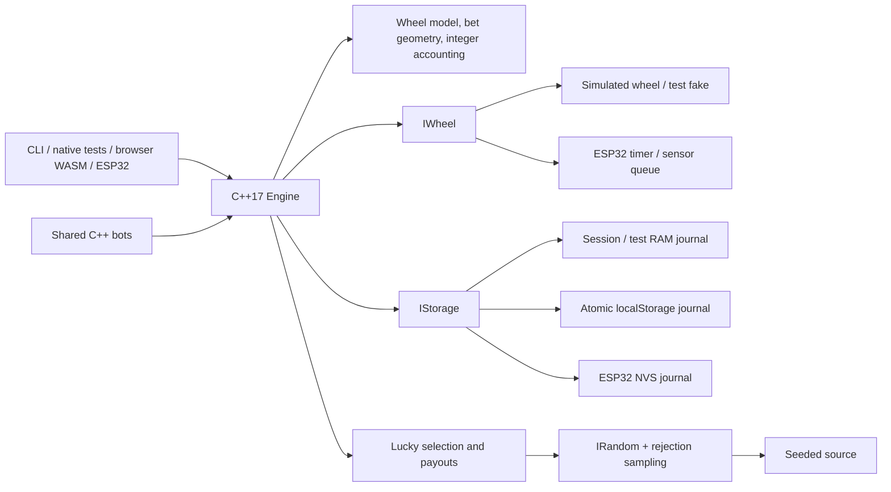

# mini-etg-roulette

**Live demo** · [Play roulette](https://aeioi-98.github.io/mini-etg-roulette/#/play) ·
[Operator dashboard](https://aeioi-98.github.io/mini-etg-roulette/#/operator) ·
[Run locally](docs/PHASE_3B_GUIDE.md) · [ESP32 in Wokwi](docs/PHASE_4_GUIDE.md)

A portable C++17 model of European roulette, built as a portfolio project. The
desktop simulator and browser player terminal share one engine. An operator
dashboard exposes the ledger, faults and recovery. An ESP32 wheel controller
runs that engine against timer-driven sensors, an OLED and an NVS journal.

**Educational demo only. No real money. Not certified gaming software.**
No company products or proprietary features are reproduced.

**The browser terminal is live on GitHub Pages.** The player terminal supports all 157
legal selections on the table or in an accessible list. The operator dashboard
shows eight seats, numbered events, fault injection, recovery and live RTP and
frequency charts. The ESP32 controller is implemented and tested in Wokwi.

## Run the ESP32 wheel in Wokwi

[Start with the Wokwi guide](docs/PHASE_4_GUIDE.md) for the prebuilt firmware,
circuit and simulator. With PlatformIO and the Wokwi VS Code extension, open
this repository, run `pio run -e esp32dev`, then choose **Wokwi: Start Simulator**.

Tap **Bets** to stake 10 demo credits on red. Tap it again to close betting,
then tap **Launch**. **Fault** drops a pocket pulse so you can see the refund.
Hold **Launch** for 1.2 seconds while bets are open to reboot the chip and see
NVS restore the balance on the OLED.

## Run the browser terminal

With Node 24 and an activated Emscripten 4.0.22 SDK, run:

```sh
cd web
npm ci
npm run build
npm run preview
```

Open the Local URL printed by Vite. Choose **Player terminal** to place chips or
**Operator** to inspect the same round. For a quick recovery demo, place a chip
and reload while bets are open. The journal records the void and returns the
outstanding stakes. [Build instructions and walkthrough](docs/PHASE_3B_GUIDE.md)

## Run the desktop simulator

From this repository, with Python 3 and a C++17 compiler installed:

```sh
python3 sim/run.py --seed 42 --rounds 5 --lucky-mode
python3 sim/run.py --seed 42 --rounds 3 --lucky-mode --inject-fault=ball-timeout
```

The wrapper builds and runs the C++ executable. It prints every round's states,
Lucky draw, result, per-seat gross return/refund/net change and final meters.
All game decisions stay in the shared engine. Runs use virtual time and a bounded
RAM journal; the maximum is 10,000 rounds and there are no automatic credit top-ups.

Fault options are `no-spin`, `ball-timeout`, `invalid-sensor`, `start-failure` and
`power-loss`. They affect the first round only. The power-loss option reloads the
surviving RAM journal; it does not test persistence across process exit.
See the [simulator guide](docs/PHASE_3_GUIDE.md) and
[saved fault demonstration](sim/examples/lucky-fault-demo.txt).
All **9 CLI integration checks pass**, including a 10,000-round run:

```sh
python3 sim/test_cli.py
```

## Run the native tests

From this repository, with Python 3 and a C++17 compiler installed:

```sh
python3 -m venv .venv
source .venv/bin/activate
python -m pip install -r requirements-dev.txt
pio test -e native
```

For the prepared local checkout:

```sh
source .venv/bin/activate
pio test -e native
```

The first run downloads PlatformIO's native platform, build tools and Unity test
framework. PlatformIO and build caches stay in the ignored `.pio-core/` and
`.pio/` directories. Tests compile with warnings as errors, exceptions disabled
and RTTI disabled. Windows users can activate `.venv\Scripts\activate`
instead of the POSIX `source` command.

**153 native cases passed** across 11 suites.

- `test_domain`: exact wheel order and colours, every valid bet selection against
  all 37 results, invalid geometry, integer boundaries and RNG rejection draws.
- `test_storage`: snapshot integrity, accounting, atomic old-or-new commits,
  contiguous events, corruption, storage capacity and reserved terminal counters.
- `test_engine`: command/state guards, eight seats, limits, payouts/refunds,
  delayed sensors, timer rollover, atomic undo/clear/repeat, crash recovery and
  absence of C++ heap allocation in exercised round paths.
- `test_lucky`: weighted selection, distinct numbers, configurable base payouts,
  full-width multipliers, unchanged other bets, analytical RTP and variance.
- `test_lucky_engine`: atomic reveal, saved-multiplier recovery, corrupt draws,
  worst-case payout headroom and reserved reveal/resolution capacity.
- `test_sim_shared`: seeded wheel observations, one-shot faults, all eight bot
  strategies, affordability, full engine rounds and allocation checks.
- `test_sim_journal`: the session RAM journal's atomic publication, immutable
  event prefix, capacity reserves and recovery after recreating the engine.
- `test_sensor` covers all 37 landings, missing and excess pulses, a late fault
  request, timer rollover and a full interrupt queue.
- `test_nvs_journal` exercises torn publication, corrupt archives and recovery
  across a 128-wager payout.
- `test_serial` checks CRC, escaping, framing and recovery from a broken stream.
- `test_firmware_buttons` checks bounce, reset holds and timer rollover.

See the [Phase 1 walkthrough](docs/PHASE_1_GUIDE.md) for a complete round example
and explanations aimed at a JavaScript developer. The
[design and header index](docs/PHASE_1_PROPOSAL.md) documents the detailed contracts.

## Lucky Numbers and measured RTP

Lucky mode is optional and off by default. After betting closes, it selects 1–5
distinct numbers and weighted gross multipliers of 50×–500×. Straights otherwise
pay 29:1 profit; all other bets keep their standard payouts. A 50× win returns
50 times the stake in total. The configuration and enabling example are explained
in [MATH.md](docs/MATH.md).

Run the analytical calculation and the shared-core Monte Carlo experiment:

```sh
python3 tools/run_math.py --spins 10000000 --seed 20261111
```

The default table has **97.297297% theoretical RTP**, exactly equal to standard
roulette's 36/37. This seeded run produced:

| Experiment | Spins | Observed RTP | Approximate 95% interval |
| --- | ---: | ---: | --- |
| Standard, one credit on number 0 | 10,000,000 | 96.909480% | 96.548349%–97.270611% |
| Lucky, one credit on number 0 | 10,000,000 | 96.848700% | 96.371746%–97.325654% |
| Lucky, one credit on each of 37 numbers | 10,000,000 | 97.270592% | 97.219625%–97.321559% |

The last experiment wagers 37 credits per spin and measures the same per-credit
expectation with lower variance. Its interval uses ten million independent spins,
not 370 million independent bets. The fixed-number standard interval misses the
theoretical value in this sample; a 95% interval is not guaranteed to contain it.
All original results and seeds are retained.

Wheel chi-square was **39.909041** with 36 degrees of freedom, below the 1%
critical value of 58.619; this run does not reject uniformity. The
[full report](tools/results/RESULTS.md) includes exact credit totals, seeds and
draw diagnostics. [Convergence](tools/results/convergence.csv) and
[histogram](tools/results/histogram.csv) CSV files are ready for Phase 5 plotting.
Four tooling checks also pass: `python3 tools/test_math_tool.py`.

## Architecture and decisions



All amounts use checked `int64_t` credits. Fixed arrays bound memory to eight
seats and sixteen placements per seat. Each accepted bet is checked against all
37 possible results, at base and maximum Lucky payouts, so an eventual win cannot
overflow the ledger.

The engine writes the next snapshot and its events as one transaction before
publishing the change in RAM. Recovery refunds a round without a recorded result;
once a result exists, recovery completes its payout exactly once. Event capacity
and sequence/revision values are reserved for finishing outstanding rounds.
Lucky draws and their reveal event are saved with the closing transition;
recovery uses the saved values without consuming randomness.

`IWheel`, `IStorage` and `IRandom` separate rules from devices. The simulator's
reusable bots, seeded RNG and wheel live in `sim/shared/`, separate from CLI
parsing and printing. Wheel, Lucky and bot decisions use separate seeded streams.
The memory journal survives recreation of an engine; it does **not** survive
process exit. The browser uses localStorage. The ESP32 archives events in flash
and publishes each new ledger through NVS.

## Design principle: the engine decides, the presentation follows

The C++ engine records the result before the browser reveals it. The wheel
rotation and ball deceleration are computed to land on that recorded pocket.
The engine schedules payout independently of the animation. A skipped frame,
a reduced-motion preference or a reload cannot pick a different number.

Emscripten compiles the same C++ files used by the simulator into WebAssembly.
Embind exposes a small C++ class that TypeScript can call like a JavaScript
object. Clicking a chip sends a command into C++. Once the engine has validated
and saved it, the browser draws the accepted bet and updated credit meter.
The wheel, rules, payouts and seven bots run in C++.
[How the bridge, journal and charts work](docs/PHASE_3B_GUIDE.md)

## Planned demo media and results

- Web terminal GIF: slot reserved for a recording of the implemented terminal.
- Wokwi recording: slot reserved for the ESP32 demo, OLED wheel/result and recovery.
- Monte Carlo charts: Phase 5 `tools/plots.py` will generate RTP convergence and
  result-distribution PNGs from Phase 2 measurements for this README.

## Built with AI assistance

AI agents proposed the interfaces, implemented Phases 1–4 after user approval, wrote
tests and reviewed the code independently. The native test suite runs the actual
C++ implementation. See [AI_WORKFLOW.md](docs/AI_WORKFLOW.md) for findings, fixes
and validation performed in this session. Human review is still required at each
phase boundary.

Projekt je učni prikaz evropske rulete s skupnim jedrom v jeziku C++17.
Ne uporablja pravega denarja in ni certificirana programska oprema za igre na srečo.
Namizni simulator, spletni terminal in krmilnik ESP32 v Wokwi uporabljajo isto
jedro. Na zaslonu OLED so vidni rezultat, vračilo stave in obnovitev po ponovnem zagonu.
