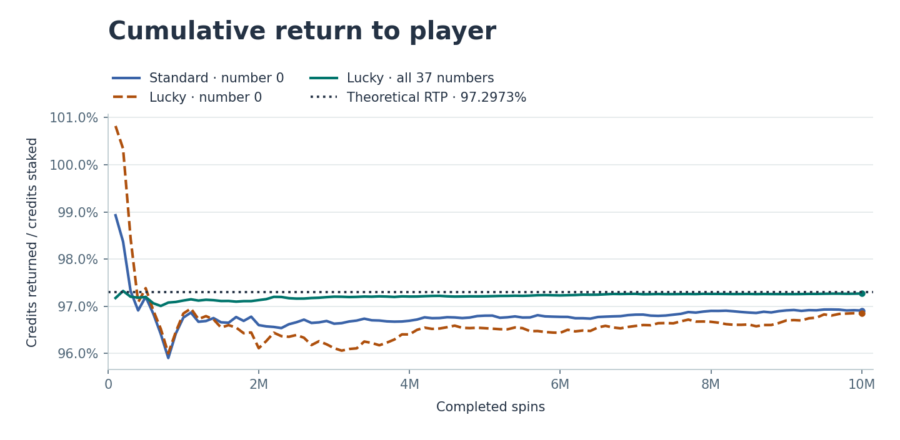
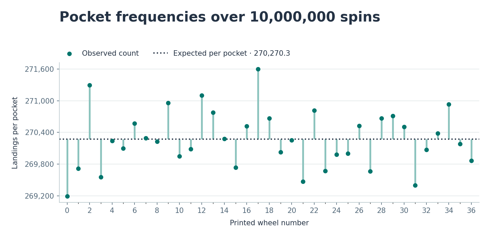
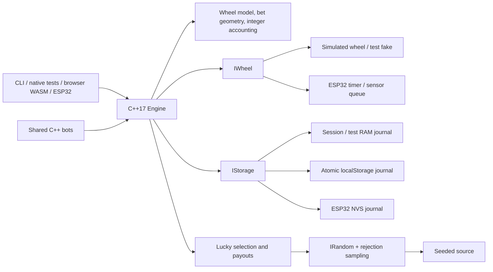
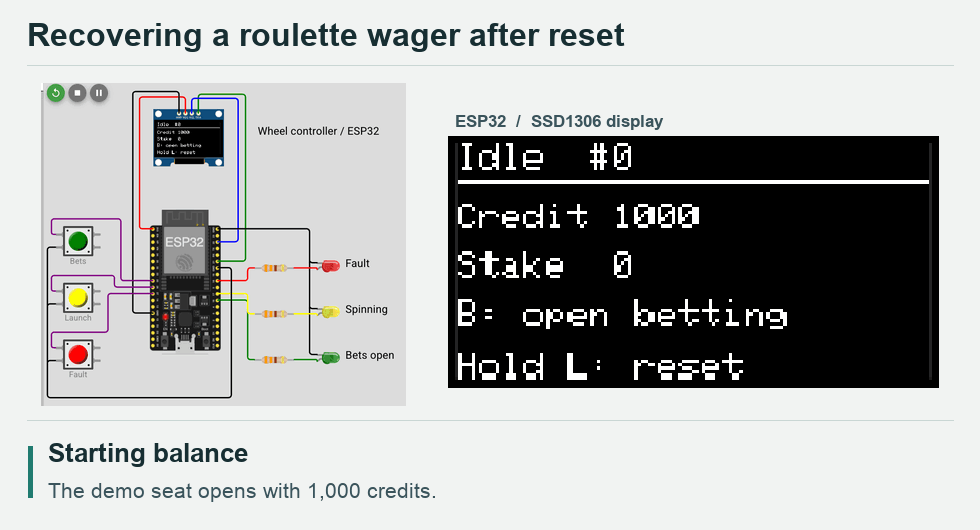

# mini-etg-roulette

**Live demo** · [Play roulette](https://aeioi-98.github.io/mini-etg-roulette/#/play) ·
[Operator dashboard](https://aeioi-98.github.io/mini-etg-roulette/#/operator) ·
[Run locally](docs/PHASE_3B_GUIDE.md) · [ESP32 in Wokwi](docs/PHASE_4_GUIDE.md)

One C++17 engine runs European roulette on the desktop, in a browser and on an
ESP32. Place a bet in the player terminal, then open the operator dashboard to
see how the wager moves through escrow, payout or refund. The Wokwi demo shows
the same round on an ESP32 with simulated wheel sensors and an OLED.

**Educational demo only. No real money. Not certified gaming software.**
No company products or proprietary features are reproduced.

To follow one wager through all three targets, start with the 10-credit bet on
red. The walkthrough includes a runnable native/WebAssembly comparison and
an interview demo of a reset before and after the result. [Build plan and first wager](docs/BUILD_PLAN.md)

## Run the ESP32 wheel in Wokwi

[Start with the Wokwi guide](docs/PHASE_4_GUIDE.md) for the prebuilt firmware,
circuit and simulator. With PlatformIO and the Wokwi VS Code extension, open
this repository, run `pio run -e esp32dev`, then choose **Wokwi: Start Simulator**.

Tap **Bets** to stake 10 demo credits on red. Tap it again to close betting,
then tap **Launch**. **Fault** drops a pocket pulse so you can see the refund.
Hold **Launch** for 1.2 seconds while bets are open to reboot the chip and see
NVS restore the balance on the OLED. [Watch the reset demo](#esp32-reset-recovery-in-wokwi)

## Run the browser terminal

With Node 24 and an activated Emscripten 4.0.22 SDK, run:

```sh
cd web
npm ci
npm run build
npm run preview
```

Open the local URL printed by Vite. The player terminal offers 157 legal bet
selections on the table or in an accessible list. Choose **Operator** to see all
eight seats, the numbered event log and live charts. For a quick recovery demo,
place a chip and reload while bets are open. The journal records the void and
returns the stake. [Build instructions and walkthrough](docs/PHASE_3B_GUIDE.md)

## Run the desktop simulator

From this repository, with Python 3 and a C++17 compiler installed:

```sh
python3 sim/run.py --seed 42 --rounds 5 --lucky-mode
python3 sim/run.py --seed 42 --rounds 3 --lucky-mode --inject-fault=ball-timeout
```

The wrapper builds and runs the C++ executable. It prints every round's states,
Lucky draw, result, per-seat gross return/refund/net change and final meters.
All game decisions stay in the shared engine. Runs use virtual time and a bounded
RAM journal; the maximum is 10,000 rounds and there are no automatic credit top-ups.

Fault options are `no-spin`, `ball-timeout`, `invalid-sensor`, `start-failure` and
`power-loss`. They affect the first round only. The power-loss option reloads the
surviving RAM journal; it does not test persistence across process exit.
See the [simulator guide](docs/PHASE_3_GUIDE.md) and
[saved fault demonstration](sim/examples/lucky-fault-demo.txt).
All **9 CLI integration checks pass**, including a 10,000-round run:

```sh
python3 sim/test_cli.py
```

## Run the native tests

From this repository, with Python 3 and a C++17 compiler installed:

```sh
python3 -m venv .venv
source .venv/bin/activate
python -m pip install -r requirements-dev.txt
pio test -e native
```

The first run downloads PlatformIO's native platform, build tools and Unity test
framework. PlatformIO and build caches stay in the ignored `.pio-core/` and
`.pio/` directories. Tests compile with warnings as errors, exceptions disabled
and RTTI disabled. Windows users can activate `.venv\Scripts\activate`
instead of the POSIX `source` command.

On pushes and pull requests, GitHub Actions runs the native, CLI, math and
serial monitor tests and builds the ESP32 firmware. Pull requests and builds
of `main` also compile WebAssembly and exercise the terminal in Chrome.
Successful builds of `main` publish to Pages.
[CI runs](https://github.com/AEIOI-98/mini-etg-roulette/actions/workflows/deploy-web.yml)

<details>
<summary>What the 153 native tests cover</summary>

- `test_domain`: exact wheel order and colours, every valid bet selection against
  all 37 results, invalid geometry, integer boundaries and RNG rejection draws.
- `test_storage`: snapshot integrity, accounting, atomic old-or-new commits,
  contiguous events, corruption, storage capacity and reserved terminal counters.
- `test_engine`: command/state guards, eight seats, limits, payouts/refunds,
  delayed sensors, timer rollover, atomic undo/clear/repeat, crash recovery and
  absence of C++ heap allocation in exercised round paths.
- `test_lucky`: weighted selection, distinct numbers, configurable base payouts,
  full-width multipliers, unchanged other bets, analytical RTP and variance.
- `test_lucky_engine`: atomic reveal, saved-multiplier recovery, corrupt draws,
  worst-case payout headroom and reserved reveal/resolution capacity.
- `test_sim_shared`: seeded wheel observations, one-shot faults, all eight bot
  strategies, affordability, full engine rounds and allocation checks.
- `test_sim_journal`: the session RAM journal's atomic publication, immutable
  event prefix, capacity reserves and recovery after recreating the engine.
- `test_sensor` covers all 37 landings, missing and excess pulses, a late fault
  request, timer rollover and a full interrupt queue.
- `test_nvs_journal` exercises torn publication, corrupt archives and recovery
  across a 128-wager payout.
- `test_serial` checks CRC, escaping, framing and recovery from a broken stream.
- `test_firmware_buttons` checks bounce, reset holds and timer rollover.

</details>

See the [Phase 1 walkthrough](docs/PHASE_1_GUIDE.md) for a complete round example
and explanations aimed at a JavaScript developer. The
[design and header index](docs/PHASE_1_PROPOSAL.md) documents the detailed contracts.

## Lucky Numbers and measured RTP

New browser tables enable Lucky Numbers. The desktop simulator enables it with
`--lucky-mode`, and the ESP32 demo uses standard payouts. In Lucky mode, the
engine selects 1–5 distinct numbers after betting closes and assigns weighted
gross multipliers of 50×–500×. A 50× win returns 50 times the stake in total.
Other winning straight bets pay 29:1 profit, and all other bet types keep
their standard payouts. [Rules and derivation](docs/MATH.md)

Run the analytical calculation and the shared-core Monte Carlo experiment:

```sh
python3 tools/run_math.py --spins 10000000 --seed 20261111
```

Return to player (RTP) is the total credits returned divided by the total
wagered. With the default multiplier weights, the expected RTP is exactly
36/37 (about **97.2973%**) in both modes. The design allows a difference of
up to 0.1 percentage point in the calculated Lucky return. The simulation
reports its observed return and uncertainty for a seed chosen in advance.
[Math acceptance criteria](docs/MATH.md#what-passes-review)

| Experiment | Spins | Observed RTP | Approximate 95% interval |
| --- | ---: | ---: | --- |
| Standard, one credit on number 0 | 10,000,000 | 96.909480% | 96.548349%–97.270611% |
| Lucky, one credit on number 0 | 10,000,000 | 96.848700% | 96.371746%–97.325654% |
| Lucky, one credit on each of 37 numbers | 10,000,000 | 97.270592% | 97.219625%–97.321559% |



Covering all 37 numbers gives one winning straight on every spin. It has the
same expected return per credit as betting on zero, with less variation from
spin to spin. Its interval uses ten million independent spins. For the standard
bet on zero, the measured 95% interval fell below the theoretical return in
this run. [Convergence data](tools/results/convergence.csv)



A uniform wheel would average about 270,270 hits per number over ten million
spins. The chi-square statistic was **39.909041** with 36 degrees of freedom,
below the 1% critical value of 58.619. [Pocket counts](tools/results/histogram.csv) ·
[Full report and seeds](tools/results/RESULTS.md)

Regenerate both PNGs from the saved CSVs in a Python 3.10+ virtual environment:

```sh
python -m pip install -r tools/requirements-plots.txt
python tools/plots.py
```

## Architecture and decisions



All amounts use whole credits stored as checked 64-bit integers, so placing and
settling bets requires no rounding. Fixed arrays bound memory to eight
seats and sixteen placements per seat. Each accepted bet is checked against all
37 possible results, at base and maximum Lucky payouts, so an eventual win cannot
overflow the ledger.

The engine writes the next snapshot and its events as one transaction before
publishing the change in RAM. Recovery refunds a round without a recorded result;
once a result exists, recovery completes its payout exactly once. Event capacity
and sequence/revision values are reserved for finishing outstanding rounds.
Lucky draws and their reveal event are saved with the closing transition;
recovery uses the saved values without consuming randomness.

`IWheel`, `IStorage` and `IRandom` separate rules from devices. The simulator's
reusable bots, seeded RNG and wheel live in `sim/shared/`, separate from CLI
parsing and printing. Wheel, Lucky and bot decisions use separate seeded streams.
The memory journal survives recreation of an engine; it does **not** survive
process exit. The browser uses localStorage. The ESP32 archives events in flash
and publishes each new ledger through NVS.

To choose one of 37 pockets uniformly, the code draws a 32-bit random word.
There are seven values left over when the full range is divided by 37. The
code redraws values 0–6, then takes the remainder modulo 37. Each pocket now
has exactly the same number of accepted values. [Random draw implementation](core/src/random.cpp)

On the ESP32, a timer interrupt puts timestamped sensor readings into a fixed
queue. The main loop remembers the pocket where the ball settled and waits for
the next zero crossing to confirm it counted exactly 37 pulses. A missing
pulse voids the round and refunds the stake. Keeping display and journal writes
in the main loop lets the interrupt return quickly. [Controller walkthrough](docs/PHASE_4_GUIDE.md)

## Design principle: the engine decides, the presentation follows

The C++ engine records the result before the browser reveals it. The wheel
rotation and ball deceleration are computed to land on that recorded pocket.
The engine schedules payout independently of the animation. A skipped frame,
a reduced-motion preference or a reload cannot pick a different number.

Emscripten compiles the same C++ files used by the simulator into WebAssembly.
Embind exposes a small C++ class that TypeScript can call like a JavaScript
object. Clicking a chip sends a command into C++. Once the engine has validated
and saved it, the browser draws the accepted bet and updated credit meter.
The wheel, rules, payouts and seven bots run in C++.
[How the bridge, journal and charts work](docs/PHASE_3B_GUIDE.md)

## Demo recordings

### ESP32 reset recovery in Wokwi



This run shows both sides of the journal write. The first reset refunds the
open wager. In the next round the sensor records red 23, and recovery credits
the 20-credit gross return. The last reset shows **Already paid** and the
same 1,010 credits. The recorded take was selected for its red win.
[Perform the demo and trace the journal write](docs/BUILD_PLAN.md#lead-the-recovery-demonstration)

**Web terminal GIF** — reserved for a round from bet placement through payout.

## Built with AI assistance

AI agents proposed interfaces, implemented the engine and its three targets,
wrote tests, and prepared the charts and CI workflow. The development log
records what tests caught, how the code changed, and which checks ran in
Wokwi. [AI development log](docs/AI_WORKFLOW.md)

Namizni simulator, spletni terminal in krmilnik ESP32 v simulatorju Wokwi
uporabljajo skupno jedro za evropsko ruleto, napisano v jeziku C++17.
Po ponovnem zagonu krmilnik iz dnevnika obnovi stanje in na zaslonu OLED
prikaže vračilo stave ali izid izplačila. Projekt je namenjen učenju, ne
uporablja pravega denarja in ni certificiran za igre na srečo.
