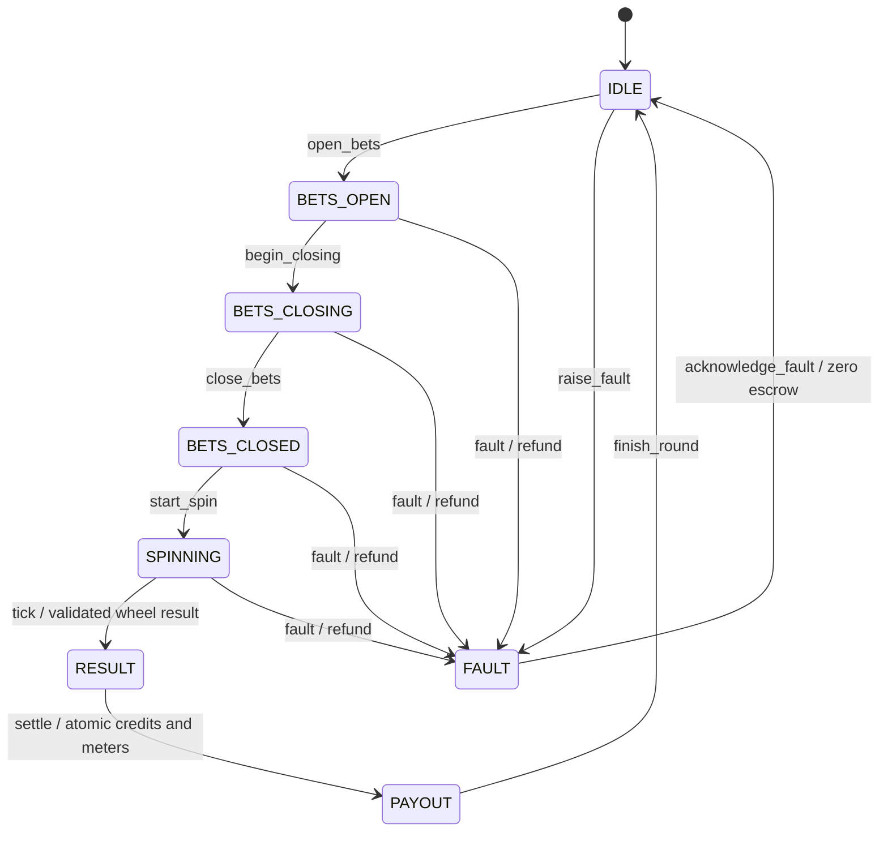

# Phase 1: proposed structure and public interfaces

Status: **proposal awaiting the user's OK**. Runtime functions are declarations
only. Default field values and fixed capacity constants are included so the types
are readable. No Phase 1 game behavior has been implemented.

The user has since added [Phase 3B and Phase 4–5 extensions](PHASE_3B_PROPOSAL.md).
Its core API implications are recorded there; the existing headers are still the
original proposal. The two issues from the bug review (sensor observation times
and terminal counter reservations) remain open and must be resolved before the
affected implementation is accepted.

## Folder structure

Paths marked `[later]` are a plan, not existing implementations.

```text
mini-etg-roulette/
├── README.md
├── platformio.ini                         [later: native + ESP32 environments]
├── core/
│   ├── library.json                       [later: shared PlatformIO library]
│   ├── include/mini_etg/
│   │   ├── types.hpp
│   │   ├── random.hpp
│   │   ├── wheel.hpp
│   │   ├── bet.hpp
│   │   ├── model.hpp
│   │   ├── events.hpp
│   │   ├── storage.hpp
│   │   └── engine.hpp
│   └── src/                               [later: matching .cpp definitions]
├── test/                                  [later: PlatformIO test discovery]
│   ├── test_native/
│   │   ├── test_main.cpp
│   │   ├── test_wheel.cpp
│   │   ├── test_random.cpp
│   │   ├── test_bets.cpp
│   │   ├── test_accounting.cpp
│   │   ├── test_round.cpp
│   │   ├── test_events.cpp
│   │   └── test_recovery.cpp
│   └── support/
│       ├── seeded_random.hpp
│       ├── fake_wheel.hpp
│       └── memory_storage.hpp
├── sim/
│   ├── src/                               [Phase 3: CLI]
│   └── shared/                            [Phase 3: C++ bots, RNG, simulated wheel]
├── web/                                   [Phase 3B: Vite + TypeScript]
│   ├── wasm/                              [embind + browser adapters]
│   ├── src/                               [player/operator views + rendering]
│   └── test/                              [bridge, interactions, recovery, visual QA]
├── firmware/
│   ├── src/                               [Phase 4: adapters + non-blocking loop]
│   ├── diagram.json                       [Phase 4]
│   └── wokwi.toml                         [Phase 4]
├── tools/                                 [Phases 2, 4 and 5: math, monitor, plots]
├── docs/
│   ├── PHASE_1_PROPOSAL.md
│   ├── PHASE_3B_PROPOSAL.md
│   ├── AI_WORKFLOW.md
│   └── MATH.md                            [Phase 2]
└── .github/workflows/
    ├── deploy-web.yml                     [Phase 3B: GitHub Pages]
    └── ci.yml                             [Phase 5: full native/firmware checks]
```

Tests live in the same repository and arrive with each implementation step.
PlatformIO's `test/` location keeps `pio test -e native` straightforward.
Desktop, test, browser WASM, and ESP32 adapters will all use the same `core/` library.
There will be no Arduino headers in `core/`.

## Public header index

These files contain the complete proposed declarations, not snippets.

| Header | Responsibility |
| --- | --- |
| [types.hpp](../core/include/mini_etg/types.hpp) | Integer credits, distinct pocket/number types, capacities, states, faults, checked arithmetic |
| [random.hpp](../core/include/mini_etg/random.hpp) | `IRandom` and unbiased bounded integers |
| [wheel.hpp](../core/include/mini_etg/wheel.hpp) | European order/colours, sensor reports, `IWheel` |
| [bet.hpp](../core/include/mini_etg/bet.hpp) | Bet requests, geometry validation, canonicalization, profit odds, gross returns |
| [model.hpp](../core/include/mini_etg/model.hpp) | Limits, seats, meters, outstanding bets, complete durable snapshot |
| [events.hpp](../core/include/mini_etg/events.hpp) | Append-only event records and a fixed event batch |
| [storage.hpp](../core/include/mini_etg/storage.hpp) | `IStorage`: atomically save the ledger and append its events |
| [engine.hpp](../core/include/mini_etg/engine.hpp) | Guarded commands, recovery, read-only state, borrowed dependencies |

The engine takes `IWheel&` and `IStorage&`. Phase 1 has no direct random decision:
the simulated wheel takes an `IRandom&` and reports through `IWheel`. Later,
the multiplier feature may also use `IRandom`. No multiplier or serial-codec
interfaces are being designed before their phases.

## Wheel and bets

A sensor reports a **physical index**, not the printed number. Index 1 maps to
number 32. Separate `PocketIndex` and `Number` structs make an accidental mix-up
a compile error when passed to functions.

The proposed clockwise wheel order, starting at zero, is:

```text
0, 32, 15, 19, 4, 21, 2, 25, 17, 34, 6, 27, 13, 36, 11, 30, 8,
23, 10, 5, 24, 16, 33, 1, 20, 14, 31, 9, 22, 18, 29, 7, 28,
12, 35, 3, 26
```

This matches the single-zero sequence in the
[New Jersey State Library's archived wheel specification](https://dspace.njstatelib.org/bitstreams/bc98b66e-d87d-43ee-aabd-6c670d0fafc6/download),
section 19:46-1.7. This is a reference for wheel layout, not a claim of compliance.

A bet stores its kind and explicit covered numbers in a fixed array. This uses
more bytes than a bit mask but makes inspection and explanation simple. Convenience
builders create dozens, columns, and even-money selections; validation still runs
for caller-built selections.

Proposed geometry rules:

- Straight: one number, including zero.
- Split: two layout neighbours, including `{0,1}`, `{0,2}`, `{0,3}`.
  `{3,4}`, diagonal pairs, and repeated numbers are invalid.
- Street: a complete three-number row; also `{0,1,2}` and `{0,2,3}`.
- Corner: a 2-by-2 layout rectangle; also first-four `{0,1,2,3}`.
- Six line: two adjacent complete three-number rows.
- Dozen/column: exactly one of the three defined twelve-number sets.
- Red/black, odd/even, low/high: the exact eighteen-number set; zero loses.

The inclusion of zero trios and first-four is an explicit proposed choice. Their
11:1 and 8:1 odds respectively are shown in this
[operator's roulette layout and payout guide](https://countryclubtasmania.com.au/wp-content/uploads/2025/05/MAR2-724-WP-CC_Roulette_HowToPlay-4pDL.pdf).

| Bet | Profit odds | Gross winning return for one credit |
| --- | ---: | ---: |
| Straight | 35:1 | 36 |
| Split | 17:1 | 18 |
| Street | 11:1 | 12 |
| Corner | 8:1 | 9 |
| Six line | 5:1 | 6 |
| Dozen, column | 2:1 | 3 |
| Red/black, odd/even, low/high | 1:1 | 2 |

These are the project's requested base payouts. Returns include the original
stake, which was deducted when accepted. A loss returns zero.

Each placement must meet the configured minimum. The maximum applies to cumulative
exposure on the same canonical selection for that seat in that round, so reversing
a split's input order or submitting it again cannot bypass the limit. The per-seat
total limit also includes every accepted placement. Rejecting a bet leaves credits
and the output bet ID unchanged.

Proposed project capacity: eight seats, sixteen accepted placements per seat,
128 overall. Unused seats can have zero credits. This capacity is a memory budget,
not a roulette rule. Full capacity returns `BetCapacityReached`.

All randomness passes through `IRandom::next_u32()`. `uniform_below()` will reject
the extra part of the uint32 range before reducing it to a requested range; directly
using `word % 37` would give some results more input words than others. Tests and
the simulator will use a seeded `std::mt19937` adapter and our own bounded mapping,
so they do not depend on `std::uniform_int_distribution` sequence choices.

## State machine and wheel boundary



`place_bet()` is valid only in `BetsOpen`. `BetsClosing` rejects new bets; there
is no hidden grace period. Commands enforce their own guards: there is no public
state setter or direct result setter.

`tick(now_ms)` polls `IWheel` only during `Spinning`. A valid result must have the
current round ID, an index 0..36, and prior `MotionDetected` evidence. Missing
rotation by the no-spin deadline faults; missing a ball by the ball deadline
faults. Both deadlines start at `start_spin`. Malformed signals/fault codes,
out-of-range results, and stale round IDs fault as invalid sensor input.
The adapter validates revolution pulse counts; the core validates its reports.

Timing is passed in as uint32 milliseconds, never read from Arduino APIs. Require
`0 < no_spin_timeout_ms < ball_timeout_ms < 2^31`, frequent ticks, and unsigned
elapsed-time subtraction to handle timer wrap. Timeout/report ordering will be
explicit in tests: at or beyond a due deadline, the timeout takes precedence.

Journal `Spinning` before calling `wheel.start()`. If that hardware call fails,
refund through `Fault`. If power fails between those actions, restart also refunds.
`stop()` discards old observations before recovery or acknowledging a fault.

An illegal transition returns `IllegalTransition` and commits a rejection event
without changing the round state. Other rejected commands are logged too. A storage
failure is itself returned and latches `RecoveryRequired`; the engine must not
pretend a rejection was durably logged when the device could not store it.
Commands cannot promise durable logging before successful initialization/recovery.

**Fault policy to review:** faults before a durable valid result void the round.
After durable `Result`, settlement is compulsory to satisfy exactly-once recovery;
an attempt to void it is rejected and logged. This prevents a recorded losing
result from being replaced by a refund. `Idle -> Fault` has no active stakes and
creates an inactive fault record rather than reusing an old round baseline.

## Credits and meters

`Credits` is signed int64; seat credits stay nonnegative, while house profit may
be negative. No floating point is used for money. Addition, subtraction,
multiplication, cumulative limits, and ID/meter increments are checked before
commit. Invalid configuration is rejected.

At bet acceptance, check every possible result's settlement headroom, including
existing bets, seat balances, house result, and meter increments. This small
37-outcome check prevents an accepted win from becoming impossible to pay because
an int64 or counter would overflow. Credit loads and round opening also validate
the aggregate accounting range and counters.

The money model is:

1. Accept a bet: move stake from available seat credits into round escrow.
2. Settle: return gross winnings to the seats; add total stakes minus total gross
   returns to cumulative house result; set escrow to zero.
3. Void: return all outstanding stakes, leave house result unchanged, set escrow
   to zero. No partial refunds or partial payouts become visible.

Throughout an active round:

```text
sum(seat credits) + escrow + house result == round opening total
```

After payout or refund, escrow is zero, giving the requested invariant:

```text
sum(seat credits) + house result == round opening total
```

Across the lifetime of the ledger:

```text
sum(seat credits) + escrow + house result
    == sum(credits in) - sum(credits out)
```

`credits_in` and `credits_out` are external loads and withdrawals, including
initial funding in `credits_in`. They do not count bets or winnings. External
transfers are allowed only in `Idle`; they change the next round's starting total.
`Idle` can retain the previous result/bets for display, so its historical
`opening_total` is excluded from the current-round accounting check.

Proposed meter meanings: a seat plays a game only if it placed a bet in a
non-void round. It wins a game if its total gross returns exceed its total stakes.
Voided rounds increase neither counter. Payout commits update meters once.

## Append-only journal and recovery

`IStorage::commit()` receives a **complete next snapshot plus its event batch**.
It must make both durable atomically. Only then does the engine publish its next
in-memory state. This also journals accepted bets and credit transfers, not only
state changes.

Each accepted placement gets a `BetAccepted` event. Settlement logs `BetSettled`
for each bet, including a zero return for a loss; refunds log `BetRefunded`.
Every state change has its own event. Sequence numbers start at one, are contiguous
within/across committed batches, and never reset at a round boundary or restart.
Revisions identify whole commits. Counter exhaustion fails instead of wrapping.

A storage adapter must preserve committed events; a two-slot snapshot by itself
is not an append-only log. Finite storage returns `StorageFull`, never silently
overwrites history. Before opening/accepting, it must reserve enough snapshot and
event capacity to settle/refund the outstanding round and reach a safe state.
Rejection logging cannot spend that reserve. The native adapter will test this
contract; the later NVS adapter must implement it rather than assuming separate
key writes are one transaction.

`Snapshot` is a logical model. NVS serialization will explicitly encode versioned
fields and integrity checks, including committed event history. It must not write
raw struct bytes: padding, `size_t`, and representation are not a storage format.

| Latest durable state | Recovery action |
| --- | --- |
| `Idle` | Preserve ledger; no refund, no new payout |
| `BetsOpen`, `BetsClosing`, `BetsClosed`, `Spinning` | Atomically refund outstanding bets, mark `Refunded`, enter `Fault(PowerLoss)` |
| `Result` | Use the recorded result; atomically pay all seats, mark `Paid`, enter `Payout` |
| `Payout` | Preserve already-paid balances/meters; never repeat settlement |
| `Fault` | Preserve resolved refund and zero escrow; never refund twice |

`Resolution` is separate from `RoundState`: a fault screen cannot accidentally
make a refunded bet look unpaid. Recovery can be called repeatedly without adding
duplicate money movements or committed recovery events. `RecoveryReport` gives
the future OLED a way to show what happened without persisting another event on
every restart.

No journal means initialization is allowed. A corrupt/unsupported journal must
never be treated as empty and reset balances. If commit outcome is uncertain,
stop progression and reload durable storage before any further money command.
Do not blindly retry the failed bet: recovery, followed by inspecting its round
and events, resolves what was committed. Exactly-once here concerns the internal
credit ledger; there is no external cash device in this project.

## C++ concepts to be ready to explain

| C++ construct | Connection to JavaScript and why it is here |
| --- | --- |
| Header declarations | Like a module's public contract/type declarations. Function bodies will live in `.cpp` files; the linker connects them. These headers alone do not make a runnable program. |
| `namespace mini_etg` | Groups project names, similar to keeping exports under one module name. |
| `using Credits = std::int64_t` | A readable name for a signed, exactly 64-bit integer. Unlike JS `Number`, it stores integer credits exactly within a bounded range. It is an alias, not a new distinct type. |
| `struct Number` vs `struct PocketIndex` | Small distinct value types. Both contain one byte but cannot be passed interchangeably without explicit conversion. |
| `enum class` | A named set of values with type checking; state and fault enums cannot be mixed accidentally. Values loaded from storage/sensors still need validation. |
| `std::array<T, N>` | A fixed number of elements stored directly inside the object, unlike a growable JS array. It requires no heap allocation to hold its elements. |
| `IRandom`, `IWheel`, `IStorage` | Abstract interfaces: `= 0` means adapters must supply a method. Virtual dispatch chooses the adapter at runtime; it does not itself require heap allocation. |
| `virtual ~IWheel() = default` | A defaulted virtual destructor permits correct destruction through an interface pointer. The engine does not own or delete its adapters. |
| `IWheel&` | A borrowed reference to an existing object. The caller constructs it first and keeps it alive longer than the engine. |
| `const Snapshot&` | A read-only borrowed view. It avoids copying the ledger. It is valid only after successful initialization/recovery, and later commands can update what it shows. |
| `Error` + an output reference | Instead of throwing, return a named status and write the output on success. This keeps error paths visible. A rejected command can still append its audit event. |
| `noexcept` | A promise that an exception will not escape a function; it is not automatic error handling. Implementation will also build the core with exceptions disabled. |
| `= delete` | Prevent copying the engine. Two accidental copies could both try to control one wheel and ledger. |
| `{}` / default member values | Predictable initialization of fields. A zero-filled value is not necessarily a valid bet; validators still run. |
| `inline constexpr` vs `extern const` | Capacity constants can be shared from a header. The wheel array is declared here and will have one definition in a `.cpp` file. |

The engine owns fixed snapshots and staging buffers. Construct one engine with
sufficient lifetime, preferably static storage on ESP32 rather than a small task
stack. Round processing uses no `new`, growable containers, owning pointers, or
strings. This describes `core/`; allocation inside a future SDK adapter must be
audited separately. One task calls the engine; an ISR only hands observations to
the adapter.

## Planned acceptance checks and commits after approval

Each logical implementation commit will include its native tests and must pass
`pio test -e native`. Stop after Phase 1 for user review before Phase 2.

1. Native build setup, checked arithmetic, wheel order/colours, seeded RNG and
   rejection sampling. Test 37 unique values, 18 red/18 black, the exact sequence,
   invalid bounds, and deliberate rejection draws with a fake source.
2. Bet validation/payouts/limits. Test every valid geometry against all 37
   outcomes, zero combinations, invalid geometry and duplicates, all payout odds,
   repeated canonical selection limits, capacities, and overflow boundaries.
3. Atomic in-memory storage and event batches. Test sequence/revision continuity,
   immutable earlier events, full storage and terminal reserve, corrupt records,
   and old-or-new visibility across interrupted commits.
4. Guarded rounds, seats, accounting and faults. Exercise every command/state
   pair, transitions/rejections, eight seats, closing behavior, deadlines and
   timer rollover, stale/malformed sensor reports, no-spin and invalid-index
   refunds, and accounting after every round.
5. Recovery. Crash both before and after every durable state change, every bet
   acceptance, result recording, settlement, refund, transfer, and rejection
   commit. Restart repeatedly; check credits, meters, escrow, resolution, event
   history and sequence numbers. Specifically crash after durable `Spinning`
   before wheel start, and after durable `Payout` before RAM publication.

No implementation step above is complete yet. The current proposal needs review
before step 1 starts.
