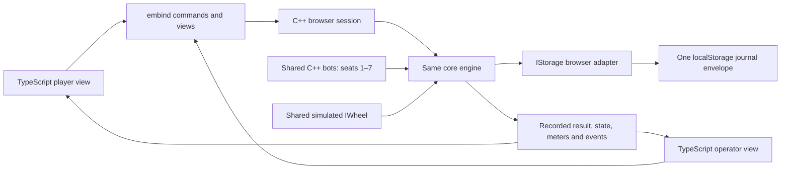

# Phase 3B — browser terminal and operator dashboard

Status: **scope added by the user; implementation pending**. This phase follows
the desktop simulator. Phases 1–3 are implemented; user review is still required
after each phase. No web application, WASM binary or deployment exists yet.

## Shared engine and the WASM bridge

Emscripten compiles the C++ engine into a `.wasm` module that runs in the browser.
Embind exposes selected C++ commands and read-only views as JavaScript calls.
Think of the bridge as a typed doorway: a click becomes a command, C++ validates
and journals it, and the browser receives state to display. There is one set of
game rules. [Official embind documentation](https://emscripten.org/docs/porting/connecting_cpp_and_javascript/embind.html)

The browser build includes the same `core/` sources and the same C++ bot strategies,
seeded RNG adapter and simulated `IWheel` used by the CLI. These reusable
simulation components are now in `sim/shared/` from Phase 3; CLI parsing is separate.
Emscripten/embind dependencies belong in `web/wasm/`, never in `core/`.



Use Vite and TypeScript with small DOM/SVG/Canvas modules and no heavy framework.
One C++ browser session owns the engine, adapters, seven bots and round schedule.
TypeScript forwards user inputs and clock samples, draws views, and supplies the
browser storage/transport glue. It does not validate winning combinations, choose
outcomes, manage credit balances, run bots, close betting by its own rules, or
calculate payouts. A displayed countdown comes from the C++ session's deadline.

Credits, IDs and 64-bit counters cross the bridge as `bigint`; persisted textual
fields use decimal strings. Do not convert money or identifiers to JS `number`.
Use `-sWASM_BIGINT` and generated/checked TypeScript declarations. Expose copied
display values rather than writable references to the engine's memory. Dispose
owned embind handles explicitly when the session ends.
[Embind conversions and ownership](https://emscripten.org/docs/porting/connecting_cpp_and_javascript/embind.html#built-in-type-conversions)

## Result first, animation second

The engine records the result before a targeted wheel animation is created.
TypeScript receives the pocket index and the engine's wheel order/colours, then
computes a decelerating wheel/ball path that ends at that pocket. Rendering may
use floating point for angles and easing; credit arithmetic remains integer C++.

Engine state and presentation phase are distinct. During detection the engine
can be `Spinning`; once a valid result is committed it is `Result`, even if the
visual reveal is still spinning. Show both accurately, particularly in the
operator view. The C++ session schedules settlement; an animation callback never
supplies a result or controls whether money is paid. Preserve visible result and
payout stages without holding settlement hostage to rendering.

Skip/reduced-motion, hidden-tab throttling and reload must retain the recorded
outcome. On restart, recover the engine first, then display its recovered state.
Lucky numbers and multipliers also come from the engine's persisted round data;
the reveal animation does not select or reroll them. This principle is also in
the root README.

## Player terminal

- Human player: seat 0. Seats 1–7 use Phase 3's C++ simulator bots and strategies.
- Touchscreen-first landscape design at 1920×1080; verify at 1366×768 and 1280×720.
  Use original typography, spacing and visual treatment, with no company branding
  or copied product layout. Proposed direction: charcoal, warm neutral panels and
  teal controls, with conventional red/black/green reserved for roulette meaning.
- Canvas or SVG wheel with the correct European pocket order, ball deceleration
  and a clear settle on the committed result. Test all 37 final positions.
- Betting layout for straight, split, street, corner, six line, dozen, column,
  red/black, odd/even and low/high, including Phase 1's zero combinations.
  Enlarged hit regions on edges/intersections select the inside bets. Highlight
  exactly what will be submitted; define deterministic precedence where hit areas
  overlap. Use engine-provided selections/labels rather than duplicate rules.
- Chip selector, undo, clear and repeat-last-bet controls. Display C++ rejection
  reasons for minimum/maximum stake, cumulative exposure, seat total, insufficient
  credits or capacity. A rejected input must not leave a phantom chip on screen.
- Show all states: Idle, bets open with countdown, closing/no more bets, closed,
  spinning/detection, result/reveal, payout and fault/refund. Disable betting once
  the engine leaves `BetsOpen`. Reveal the engine's lucky numbers and multipliers
  with animation when that mode is active.
- Visible focus, keyboard alternatives and reduced motion complement touch input;
  result and fault information must not rely on animation or colour alone.

## Core changes required by the controls

These are proposed additions for the next header revision, not implemented APIs:

```cpp
Error undo_last_bet(SeatId seat) noexcept;
Error clear_bets(SeatId seat) noexcept;
Error repeat_last_bets(SeatId seat) noexcept;
```

All three are guarded C++ commands, valid only in `BetsOpen`. Undo cancels the
seat's most recent active placement and returns its full stake. Clear cancels all
active placements for that seat. Cancellation updates escrow and credits in the
same journal transaction and adds cancellation events; it never deletes history
or reuses a bet ID. Cancelled bets do not participate in exposure, settlement or
RTP. The proposed sixteen-bet limit becomes sixteen **active** placements per seat.

Undo and clear must also preflight the proposed remaining portfolio against all
37 results for all seats, house result and meters, then commit all or none.
Removing a bet can remove a losing stake that offsets another seat's winning
return. Thus returning a stake can make a future settlement overflow even though
the refund itself fits. If any resulting settlement is unsafe, return
`ArithmeticOverflow` without cancelling bets or moving credits; display the
rejection and retain the existing chips. Preserve terminal journal reserves too.

Boundary case for the native tests: let `M = INT64_MAX`, current house result be
`-M + 35`, seat credits at round opening be `[35, M - 70, 0, ...]`, and accept a
35-credit black bet for seat 0 plus a two-credit straight bet on red number 1 for
seat 1. Every outcome fits before cancellation. Cancelling the black bet would
make a number-1 win leave the house at `-M - 35`, below `INT64_MIN`. Reject that
cancellation atomically. A seat whose bets are all cleared before closing has
not played a game; neither games-played nor games-won increases for it.

Repeat submits the pattern of selections/stakes from that seat's last completed,
non-void participating round. Store that pattern in the journal so it survives
new-round clearing and reload. Validate the entire repeated pattern against
current credits, limits, existing bets, capacity and payout headroom, then accept
all or none in one commit. It adds to existing bets; a second repeat is subject
to the same cumulative limits. Undo after repeat removes its most recent placement.

The Phase 1 contracts now use timestamped wheel batches and preserve terminal
event/revision headroom after every commit, including rejected commands. Their
runtime boundary tests remain prerequisites. Extend event types, snapshots, the
shared reserve calculation and its path-coverage tests for cancellation and repeat.
Phase 2 already journals multiplier draws and reserves their reveal event.

## Operator dashboard and reload recovery

Use separate routes `#/play` and `#/operator`. Switching views in one tab retains
the same session. The dashboard shows each seat's credits and accounting meters,
the actual engine state, and a scrolling event log with monotonic sequence numbers.

Only one tab may own a writable session. Acquire an exclusive Web Lock before
initializing/recovering; additional tabs remain read-only and can observe committed
updates. If locking is unavailable, do not start an uncoordinated writer. Never
use a localStorage flag as a substitute for a lock. The storage specification
warns that localStorage itself provides no cross-tab locking.
[HTML storage model](https://html.spec.whatwg.org/multipage/webstorage.html#introduction),
[Web Locks](https://developer.mozilla.org/en-US/docs/Web/API/Web_Locks_API)

Implement `IStorage` with one bounded, versioned envelope containing the snapshot
and the retained event history. Replace that single localStorage value for each
commit; preserve the previous event prefix. Do not store balances and events in
separate writes. The adapter serializes exact integers deliberately and checks
the loaded format/integrity before recovery. Map browser quota/storage-access
exceptions to engine errors rather than allowing a JS exception to escape into
the C++ round loop. Reserve room and counter values for payout/refund; stop new
play when the bounded journal is full instead of silently dropping history.
[Storage operations and failure cases](https://html.spec.whatwg.org/multipage/webstorage.html#the-storage-interface)

The power-loss demo means **reload recovery from the last successful browser
commit**; it does not establish physical power-failure durability of the browser's
disk storage. Reload before durable `Result` refunds once and shows recovery;
reload at `Result` completes payout once; reload at `Payout` preserves it.

Fault buttons arm the simulated wheel to suppress ball detection or emit a bad
sensor reading. Support injection during the pre-result window or for the next
spin. Show the resulting engine fault, cancelled round and refunds. Once a result
is recorded, preserve compulsory settlement; a visual spin already revealing that
result cannot be retroactively voided.

## Live charts and shared math

Compute chart data in shared C++ analysis code using committed round events.
TypeScript draws the supplied data. Distinguish display statistics from money:
plot coordinates and ratios may be floating point, while all underlying credit
amounts and totals remain checked integers.

- Observed RTP = total gross returns / total settled stake. Exclude cancelled
  bets, void/refund rounds and external credit transfers. Show “no settled bets”
  before the denominator is positive.
- The reference line uses the analytical RTP of the actual rules/configuration
  and stake-weighted wager mix. Do not hardcode the standard 36/37 reference for
  all multiplier configurations. Display sample size and mode; small samples are
  expected to fluctuate.
- Result histogram: one entry per completed valid round, with expected count
  `N / 37` for each pocket. Never count a recovery or replay as another spin.
- Rebuild aggregates from committed history, or journal the aggregates atomically
  with their last processed sequence. Repeated recovery cannot add another payout
  to the plotted totals.

## Optional Web Serial

Implement only if the user has real hardware, after the Phase 4 protocol exists.
Target Chrome/Edge with feature detection and an explicit Connect action. JS moves
raw bytes; the existing C++ frame/CRC-16 codec compiled to WASM validates and
decodes them, including split, truncated and corrupt frames. Show disconnects
and sequence gaps. [Browser serial connection model](https://developer.chrome.com/docs/capabilities/serial)

This optional mode initially monitors the ESP32's authoritative session. Do not
run a second browser game that settles the same hardware round independently.
Keep browser simulation and hardware monitoring clearly identified modes.

## Build, deployment and checks

Shared simulation components now exist; web and deployment additions remain planned:

```text
sim/shared/                   implemented C++ bots, seeded RNG and simulated wheel
web/wasm/                     bindings, browser session and IStorage adapter
web/src/                      player/operator views, layout, animation and charts
web/test/                     bridge parity, UI, recovery and deployment checks
web/package.json              Vite, TypeScript and development test dependencies
web/vite.config.ts            repository base path and generated WASM assets
web/CMakeLists.txt            Emscripten build using shared C++ source files
.github/workflows/deploy-web.yml
```

Pin an Emscripten release and frontend dependencies when implementation starts.
Build WASM before Vite, publish the WASM/glue assets with the site, and verify
their URLs under the repository subpath. GitHub Pages deployment uses GitHub
Actions and Vite's repository `base`. Hash routes keep direct player/operator
links usable on static hosting. Publish the actual live URL at the top of README
after deployment succeeds. [Vite's GitHub Pages guide](https://vite.dev/guide/static-deploy.html#github-pages)

Required checks alongside `pio test -e native`:

1. Native/WASM parity for the same seed and command trace: results, accepted bets,
   returns, meters and events agree. Keep core round processing free of heap use.
2. Exact int64/uint64 bridge and storage round trips above `2^53`, including
   negative house result. Exercise adapter errors without lost/double credits.
3. Undo/clear/repeat success, atomic rejection, closing-race rejection and recovery.
   Include removal of offsetting bets near the house/seat arithmetic limits,
   checking all remaining seats and unchanged state on rejection. Fully cleared
   seats must not increment game meters. Exercise every bet hit area, overlapping
   edge region, chip value and limit.
4. All 37 animation endpoints, resize, reduced motion, hidden-tab handling and
   skipped animation leave the recorded outcome and payments unchanged.
5. Reload at every state and on both sides of commit boundaries, repeatedly;
   verify refunds, single payouts, sequence continuity and chart totals. Exercise
   quota errors, malformed journals and a second tab without two writers.
6. Review player/operator screens at the three target landscape sizes and verify
   deployed routes, `.wasm` loading and asset paths on GitHub Pages.

Each logical step gets a small commit and actual results in `AI_WORKFLOW.md`.
After Phase 3B, stop, explain the bridge/code in plain language and wait for review.

## Additions to Phase 4 and Phase 5

**Phase 4:** draw a simple wheel animation and the result number on the SSD1306
OLED. Use the same recorded-result-first principle for a targeted reveal; an
indeterminate motion indicator may show physical detection in progress. Keep
display updates scheduled from the non-blocking loop, outside the ISR. Show
fault/refund and reset recovery visibly, in Wokwi as well as on hardware.

**Phase 5:** add `tools/plots.py` to generate RTP convergence and distribution PNGs
from the Phase 2 Monte Carlo output. Plan that output now to include checkpoint
spin counts, cumulative settled stakes/gross returns, per-pocket counts, seed and
rules/configuration metadata. The plots must use measured data and the matching
analytical reference, with labelled axes and sample counts. Embed the generated
PNGs in README and retain slots for a web-terminal GIF and Wokwi recording.
Include the web checks/build in CI alongside native tests and the firmware build.
