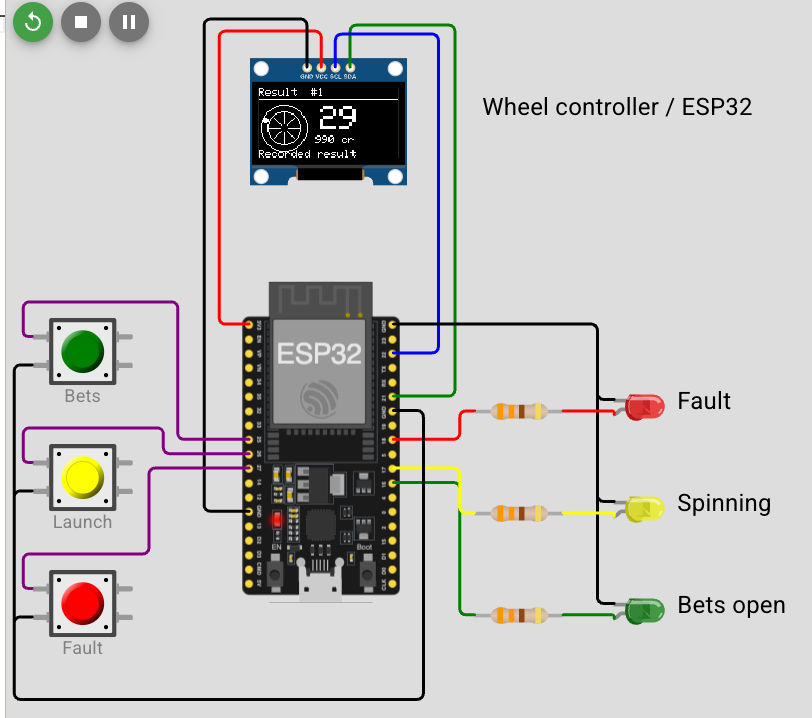

# ESP32 wheel controller in Wokwi

The ESP32 runs the same C++ roulette engine as the desktop and browser. Three
buttons operate a single demonstration seat. It starts with 1,000 credits and
places 10 on red when betting opens. Opening with fewer than 10 credits skips
the wager. The controller uses standard European payouts.

## Run in your browser

1. Download the [Phase 4 flash image](https://github.com/AEIOI-98/mini-etg-roulette/releases/download/phase-4/firmware.merged.bin)
   and open the [matching circuit JSON](https://raw.githubusercontent.com/AEIOI-98/mini-etg-roulette/phase-4/diagram.json).
2. Open [Wokwi's ESP32 custom firmware template](https://wokwi.com/projects/305457271083631168).
   Select its **diagram.json** tab and replace the entire editor contents with
   the circuit JSON. The preview should show an OLED, three buttons and three LEDs.
3. Click inside the sketch editor, press **F1**, choose **Upload Firmware and
   Start Simulation…**, then select `firmware.merged.bin`. The OLED should show
   **Idle**, **Credit 1000**, and **B: open betting**. Using Wokwi’s ordinary
   Play button on the template runs its example sketch. Use the firmware upload
   command for this controller. [Wokwi's custom firmware instructions](https://docs.wokwi.com/guides/esp32#custom-application-firmware)

## Play a round and try recovery

| Control | Action |
| --- | --- |
| **Bets** (B) | Tap to open betting, then tap again to close. In Fault it acknowledges the fault. In Payout it finishes the round. |
| **Launch** (L) | Tap when the OLED says **Bets closed** to start the wheel. Hold for 1.2 seconds to reset the running ESP32. |
| **Fault** (F) | Tap while bets are open, closing or closed to drop one pocket pulse on the coming spin. A tap during active sensing drops the next pulse. |

The green LED marks open betting, yellow marks spinning, and red marks a fault.
Buttons act on release after debouncing. The serial pane carries binary frames,
so the OLED is the easiest way to operate the demo.

- **Normal round.** Tap Bets twice, wait for **Bets closed**, then tap Launch.
  The wheel animates while the controller counts pulses. A large number appears
  at Result. After 3.2 seconds the engine pays the wager. A red win leaves the
  seat with 1,010 credits on the first round. A loss leaves 990. Tap Bets to
  finish, then tap again to open the next round.
- **Missing pulse.** Open betting, tap Fault, close betting, and launch. At the
  next zero crossing the count is short. The red LED lights, and the OLED shows
  **Bad pulse count** and **Stakes refunded**.
- **Reset before detection.** On a fresh table, open betting and watch the
  balance drop from 1,000 to 990. Hold Launch. The simulated chip reboots with
  its flash intact, refunds the stake, and shows **Recovered: refunded** with
  1,000 credits. Tap Bets to acknowledge.
- **Reset after detection.** Hold Launch as soon as the result number appears.
  Recovery pays the saved result and shows **Recovered: paid**. Hold Launch
  again on Payout. **Already paid** and the same credit balance demonstrate
  exactly-once settlement. Keep the simulation running during these resets.



## Build the image yourself

From the repository root with Python 3 and PlatformIO installed:

```sh
pio test -e native
pio run -e esp32dev
```

The default environment is the native test suite. For the board, select
`esp32dev`. A successful build produces `.pio/build/esp32dev/firmware.elf`
and `.pio/build/esp32dev/firmware.merged.bin`. The merged image contains the
bootloader, partition table, OTA boot data and application. Wokwi loads it at
flash offset zero so the dedicated journal partition is available.

In VS Code, open the repository root, install and activate the Wokwi extension,
build the board, then choose **Wokwi: Start Simulator**. The root `wokwi.toml`
and `diagram.json` select the built image and circuit.
[Wokwi's PlatformIO guide](https://docs.wokwi.com/vscode/platformio)

| Device | GPIO / connection |
| --- | --- |
| SSD1306, 128×64, address 0x3C | SDA 21, SCL 22, 3.3 V and ground |
| Bets, Launch, Fault switches | GPIO 25, 26, 27 respectively, each to ground with internal pull-up |
| Green, yellow, red LEDs | GPIO 16, 17, 18 respectively, each through 330 Ω to its LED and ground |

## How the controller knows where the ball landed

A hardware timer interrupts every 30 ms. The demo produces an index at zero,
one pocket edge per step and a separate ball-settle signal. A hardware random
word goes through the engine's rejection sampler to vary the simulated time
until the ball settles. The interrupt handler records the signal flags and
observation time in a fixed-size queue. The main loop removes and decodes them.
If the queue overflows, the decoder reports a sensor fault.

Think of the interrupt as a callback that must return quickly. The queue holds
64 observations so the normal loop can update the display or journal without
losing the timing of an edge. An ESP32 critical section keeps the reader and
interrupt from modifying the queue's indices at the same time. The loop also
feeds an eight-second task watchdog through the Arduino runtime.

At a new zero crossing, the decoder expects exactly 37 pocket pulses since the
previous crossing. It remembers the count when the ball settles and validates
that revolution at the next crossing. Only then does the engine receive the
pocket index through `IWheel` and map it to a printed number. The outcome is
journalled before the OLED aims its final animation at that pocket. The display
updates on a timer in the main loop.

## What survives a reset

The firmware uses a 512 KiB NVS partition separate from Arduino's settings.
It stores the ledger and the newest events in one record. Older groups of 16
events go to archive records first. Replacing the ledger record last makes it
the authority on which archived events belong to the round. At reboot, checksums,
sequence numbers, and balance invariants are checked before play resumes.

The journal supports 1,024 events and reserves enough capacity to settle or
refund active bets. A full journal pauses play. A reset can still resolve
outstanding stakes. The controller never erases a damaged journal as a boot
fallback. This demo verifies simulated flash retention across chip resets.

## Read the serial frames

The controller sends boot, state, result, fault and recovery messages at
115200 baud. The host monitor verifies each packet's length, sequence and CRC-16.
With the VS Code simulator running and the project Python environment activated:

```sh
python tools/monitor.py --port rfc2217://localhost:4000
```

For a physical board, use its USB serial port instead. The wire format, binary
capture mode and monitor tests are described in [SERIAL.md](SERIAL.md).
